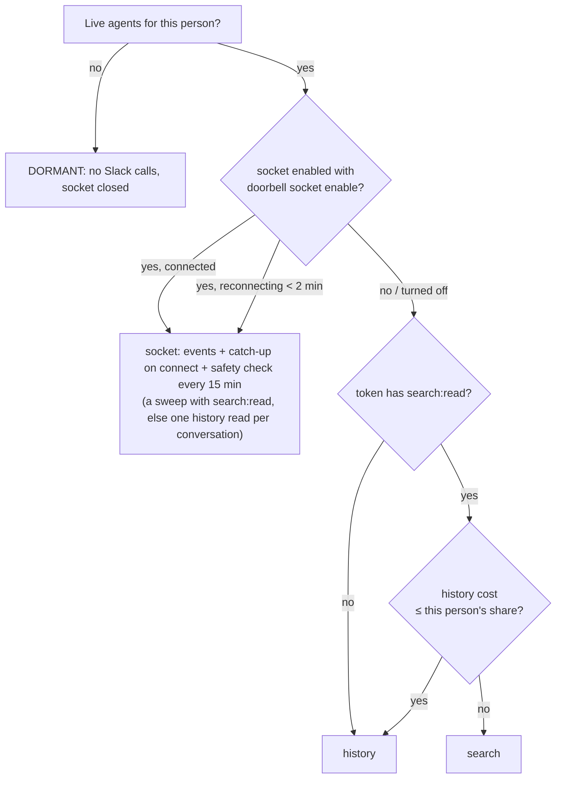
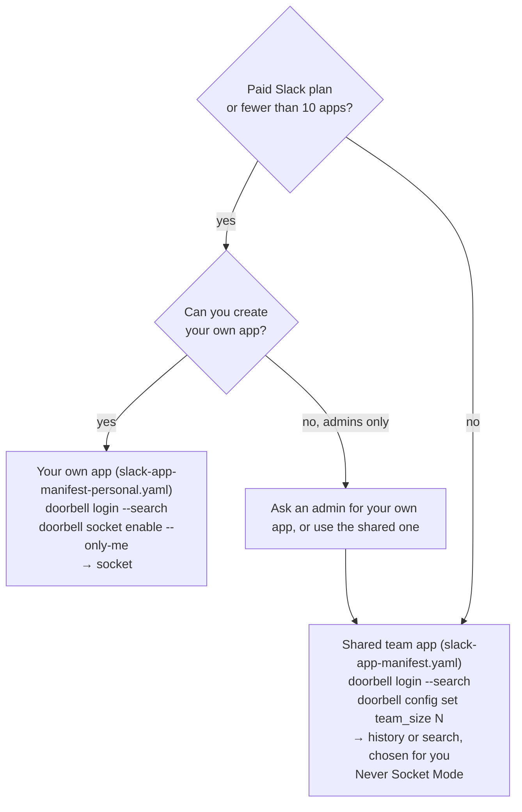

# How Doorbell finds new messages

Status: implemented in 0.4 (`doorbell/detect.py`). This page explains the design, the Slack
facts and measurements behind it, and how to pick a setup. Setting it up with Claude:
[Set it up with Claude](#set-it-up-with-claude).

## The problem

Doorbell runs on each person's machine, reads Slack as that person, and wakes their agents when
something they subscribed to arrives. Three things make "watch everything I'm in" hard:

1. **Slack's rate limits are per app, per workspace, per method.** Everyone who signs in to the
   same Slack app shares one budget per method. Slack's
   [rate limit page](https://docs.slack.dev/apis/web-api/rate-limits): limits are "applied on a
   'per API method per workspace/team per app' basis". A person in 89 conversations can't read
   each one every minute, and a team can't do it at all.
2. **No public URL, no server.** Messages are personal, so there is no central relay that sees
   everyone's messages, and nothing Slack can call over HTTPS.
3. **App count.** Slack's Free plan allows
   [10 apps](https://slack.com/help/articles/115002422943-Slack-Free-plan) per workspace, so one
   app per person isn't always possible. Paid plans have no limit.

The answer is three ways to find new messages, chosen by setup:

| Mode | How it finds new messages | Delay | Slack calls while idle | Use when |
|---|---|---|---|---|
| **socket** | Slack pushes each message over a WebSocket (Socket Mode) | under 1 s | about 0 | The Slack app is yours alone |
| **search** | One `search.messages` call every 2 minutes covers every conversation and thread; the conversation it points at is then read | up to about 2.5 min | 0.5 a minute | Shared app, big watch list |
| **history** | `conversations.history` on each watched conversation every 2 minutes | up to 2 min | 0.5 a minute per conversation | Short watch list, or no search scope |

In every mode, a conversation or thread with something new turns **hot**: it is read every 30 s
until nothing new has arrived for 2 minutes. Doorbell then leaves it to the idle schedule again.

## Slack facts this rests on

| Method | Covers | Per call | Shared budget (per app, per workspace) | Notes |
|---|---|---|---|---|
| `conversations.history` | one conversation, top-level messages | up to 999 | Tier 3: 50+ a minute | Thread replies need `conversations.replies`. Internal apps keep Tier 3 ([2025 change](https://docs.slack.dev/changelog/2025/06/03/rate-limits-clarity)) |
| `conversations.replies` | one thread | up to 1,000 | Tier 3: 50+ a minute, its own pool | Accepts the ts of any message in the thread |
| `search.messages` | everything the person can see | 100 | Tier 2: 20+ a minute | User token with `search:read`. Marked legacy; no removal date |
| `assistant.search.context` (Real-time Search, what Slack's MCP search uses) | everything the person can see | 20 | 10+ a minute (up to 400+ for large teams), and 10 a minute per user | Slack's terms forbid background use; see below |
| Socket Mode events | every message the person can see | 1 event | 30,000 events an hour | One app-level token per app; at most 10 connections; each event goes to one of them |

Every Slack Web API limit is per app, per workspace. MCP doesn't change that: Slack's MCP server
[applies the same limits](https://docs.slack.dev/ai/slack-mcp-server#rate-limits) as the Web API.

### Search

- **One call covers everything.** `search.messages` with `after:<date>`, sorted newest first,
  returns messages from every DM, group DM, channel and thread the person is in.
- **It is a pointer, not the source.** Search can merge matches that sit close together ("only
  one match will be returned"), and its results lack fields Doorbell routes on. So a match only
  says *where* to look. Doorbell then reads that conversation (or thread) with `history` /
  `replies` and routes what it reads, exactly as in history mode.
- **Indexing delay.** New messages showed up in search 6.5 to 36 s after they were posted
  (measured, below). Each sweep re-reads the last `sweep_overlap` (5 minutes), so a message
  indexed late is still found; messages already stored are skipped.
- **Thread replies.** A match's permalink normally names its thread (`?thread_ts=`). If it
  doesn't, and reading the conversation doesn't turn the match up, Doorbell asks
  `conversations.replies` with the match's own ts, which returns the thread it belongs to.

### Real-time Search is not for watching

[Real-time Search](https://docs.slack.dev/apis/web-api/real-time-search-api) has the most
generous budget for large teams, and a per-user limit on top. Slack's API terms, however, say its
use must be "transparent to and reasonably expected by users" and that "background data
collection or scraping for data unrelated to user queries is prohibited". The method page warns
against calls "outside of a user initiated action". So Doorbell never uses it to watch. It is the
right tool for the agent itself, when it searches Slack because someone asked it to (Slack's MCP
search does exactly that).

### Socket Mode

- An app-level token (`xapp-`, scope `connections:write`) opens a WebSocket with
  `apps.connections.open`. No public URL; the connection goes out from the machine.
- With user-token scopes and user event subscriptions (`message.im`, `message.mpim`,
  `message.channels`, `message.groups`), Slack pushes every message the signed-in person can see.
- **Each event goes to one connection.** The docs: "each payload may be sent to *any* of the
  connections". With two people on one app, one person's DM can arrive at the other person's
  Doorbell, and their own Doorbell never sees it. That is a privacy problem, not just a reliability
  one. Hence: **Socket Mode only on an app nobody else signs in to with read access.**
- Slack's `hello` message says how many connections are open (`num_connections`). Measured: 1 with
  one Doorbell, 2 while a second process was connected.
- Slack refreshes connections every few hours (`disconnect` with `refresh_requested`), and the
  docs don't say what happens to events while no connection is open. Measured: after a 34 s
  outage, Slack resent a missed event about 60 s after the reconnect (`retry_attempt: 2`). Doorbell
  doesn't rely on that: every (re)connect runs a search sweep from where it left off.

## Measurements

A real workspace, 2026-11-20, read-only user token plus `search:read`, self-DMs and thread
replies sent through Slack.

| What | Result |
|---|---|
| Socket Mode, top-level message | seen 0.29 to 0.44 s after posting (5 messages) |
| Socket Mode, thread reply | seen 0.31 s after posting |
| `search.messages`, polled every 10 s | seen 6.5 to 36 s after posting (9 messages) |
| Catch-up after a 34 s socket outage | 1 search call found all 4 missed messages |
| Slack resending a missed event | 60 to 75 s after the reconnect, `retry_attempt: 2` |
| Slack MCP search (Real-time Search) | a new message was found about 5 s after posting |
| One search call covering 3+ days | returned DMs, channels and threads together, newest first |
| Doorbell's own WebSocket client against Slack | handshake and `hello` work (no third-party package) |

## Is the Slack Web API the only way?

Yes, for an app that reads a person's Slack on their behalf, live:

| Alternative | Verdict |
|---|---|
| RTM API | "Granular permission Slack apps cannot use the RTM API"; classic apps "may no longer be created" |
| HTTP Events API | Needs a public HTTPS URL, which this design rules out |
| Discovery API | Enterprise Grid only, for compliance (e-discovery, archiving, DLP) |
| Audit Logs API | Enterprise only, and doesn't include message content |
| Email notifications | Bundled every 15 minutes or hourly, and only while you are away |
| Workflow Builder | Paid plans, keyword or channel triggers, and calling out needs a URL |
| Data exports | Admins only, not live |
| Desktop app notifications | Only what the app chooses to show, only while it runs; fragile |
| The Slack web client's own APIs (session tokens) | Undocumented; Slack's terms forbid relying on them |

## Cost model, per person

Calls a minute, at the defaults (`cadence_warm` 120 s, `cadence_hot` 30 s, `hot_for` 120 s).

| | history | search | socket |
|---|---|---|---|
| Idle | 0.5 × (watched conversations + watched threads) | 0.5 (one sweep) | 0.07 (a safety sweep every 15 min) |
| Each hot conversation | +2 | +2 (from the history pool) | 0 (events carry the message) |
| Each hot thread | +2 | +2 (from the replies pool) | 0 |
| Back after hours offline | 1 read per conversation | 1 call per 100 messages | 1 call per 100 messages |
| Latency | up to 2 min idle, 30 s hot | index delay (≤ ~35 s) + up to 2 min idle, 30 s hot | under 1 s |

## How Doorbell chooses (`detect: auto`)

Every poll tick, per person:

**This person's share** of the history budget is
`budget_share × min(rate_per_min, pool_history / team_size)` calls a minute, that is
0.75 × min(40, 50 / team size). History mode costs 0.5 a minute per watched conversation or
thread. History is preferred while it fits: it has no indexing delay and needs no extra scope.
Once on search, Doorbell goes back to history only when the cost falls below 80% of the share, so a
watch list that sits right at the line doesn't flip back and forth.

So "how many conversations before search?" depends on how many people share the app:

| People on the app (`team_size`) | History share (calls/min) | History up to this many watched conversations + threads |
|---|---|---|
| 1 | 30 | 60 |
| 2 | 18.8 | 37 |
| 5 | 7.5 | 15 |
| 10 | 3.8 | 7 |
| 20 | 1.9 | 3 |
| 30 | 1.25 | 2 |
| 50 | 0.75 | 1 |
| more than 75 | under 0.5 | 0: always search |

The search sweep also takes a fair share: one sweep every
`max(sweep_every, 60 / (budget_share × pool_search / team_size))` seconds.

| People on the app | Sweep every | Worst-case delay for an idle conversation |
|---|---|---|
| up to 30 | 2 min | about 2.5 min |
| 45 | 3 min | about 3.5 min |
| 60 | 4 min | about 4.5 min |
| 100 | 6.7 min | about 7 min |

Hot reads come from the history and replies pools, about 25 conversations hot at once across the
team before Slack starts asking Doorbell to wait.

## Choosing a setup

- **Your own app, Socket Mode.** Instant, about zero calls, no shared limits. Create the app from
  `slack-app-manifest-personal.yaml`, create an app-level token with `connections:write`, save it
  in a file only you can read, and run `doorbell socket enable --app-token-file <file> --only-me`.
- **Shared app.** Everyone signs in to one app. Set `team_size` to the number of people who sign
  in to it; Doorbell picks history or search and spaces its calls to its share. Socket Mode stays
  off: do not create an app-level token for a shared app, because anyone holding it receives
  everyone's events.
- **No search scope.** Without `search:read` (an app that doesn't list it, or a guest), Doorbell
  reads each watched conversation (history mode). Keep watch lists short.

## Socket Mode safety checks

`doorbell socket enable` refuses without `--only-me`. After that, Doorbell checks for itself and
turns Socket Mode off (setting `tripped`, a desktop alert, an audit entry) when:

1. **Slack's `hello` reports more than one open connection** on two connects in a row
   (`socket_max_strikes`). Someone else, or a second Doorbell, uses the app, so events would be
   split. One strike waits 30 s and reconnects, in case the old connection was just slow to close.
2. **An event isn't authorized for you alone** (someone else, or nobody named). The event is
   dropped unread, not stored, and not acknowledged, so Slack retries it on a connection that
   isn't this one.

Watching continues by search or history. `doorbell socket enable` again turns it back on.

Socket Mode stays closed while no agent is live (DORMANT means zero Slack calls).

A connection that dies without closing (a laptop asleep, a Wi-Fi change) shows up as silence:
Doorbell pings after 30 s without data and reconnects after 90 s. Connections that keep failing
quickly back off (2 s doubling to 5 min); after a long healthy connection it reconnects at once.

## After being offline

- **socket:** on every connect, a sweep reads from the stored watermark (`sweep_wm`). It reads up to
  20 pages (2,000 messages) after a gap of more than an hour, 5 pages otherwise. Each match makes
  its conversation hot, and the conversation is read from its cursor. Without `search:read`, the
  catch-up is one history read of every watched conversation (and thread you're in) instead.
- **search:** the same, on the next sweep.
- **history:** each conversation is read from its cursor (paged).
- **Too many matches.** Search also returns public channels you haven't joined, so a busy
  workspace can fill the page cap. When a sweep runs out of pages before reaching the watermark,
  Doorbell reads every watched conversation from its cursor once, so nothing is skipped.
- **First sweep after a restart or upgrade.** If conversations were read before but never swept,
  the first sweep comes with one read of each conversation from its cursor.
- Agents still cap catch-up at their own `max_catchup` (24 h by default), as before.

## When Slack says "rate limited"

- The pause is per method, with Slack's `Retry-After`. A rate-limited search doesn't stop history
  reads, and the other way round.
- A rate-limited sweep doubles the sweep interval (up to 8×), and each successful sweep halves it
  again. Any other sweep error is logged and retried at the next interval.
- A `missing_scope` answer to search (the scope was removed) doesn't stop watching: Doorbell
  switches to history mode for that sign-in.
- `doorbell status` shows all of it under `detection`: mode, why, sweep interval and slowdown,
  hot conversations and threads, socket state.

## Settings (`config.yaml`, or `doorbell config set`)

| Key | Default | Meaning |
|---|---|---|
| `detect` | `auto` | `auto`, `history`, `search` or `socket` (socket falls back to auto when not connected) |
| `team_size` | 1 | People signed in to the same Slack app; sets each person's fair share |
| `pool_history`, `pool_search` | 50, 20 | Slack's documented per-app minimums (calls a minute) |
| `budget_share` | 0.75 | Part of a pool Doorbell plans to use, leaving room for bursts and other tools |
| `cadence_hot` | 30 | Seconds between reads of a hot conversation or thread |
| `cadence_warm` | 120 | Seconds between idle reads in history mode |
| `hot_for` | 120 | Seconds without anything new before a conversation stops being hot |
| `sweep_every` | 120 | Seconds between idle sweeps (stretched to fit the share) |
| `sweep_overlap` | 300 | Seconds each sweep re-reads, for late indexing |
| `sweep_max_pages` | 5 | Pages of 100 per sweep (4× after a gap of over an hour) |
| `socket_sweep_every` | 900 | Safety sweep while Socket Mode is connected |
| `socket_max_strikes` | 2 | Connects in a row with another connection open before Socket Mode turns off |
| `login_search` | false | `doorbell login` asks for `search:read` (same as `--search`) |

## Set it up with Claude

With the Claude Code plugin installed, run `/agent-doorbell:setup`, or tell Claude "set up Agent
Doorbell". The setup skill asks the questions from [Choosing a setup](#choosing-a-setup), one at
a time, and runs the commands. You click Allow in the browser and you create the app-level token
in Slack yourself. Claude never sees a token. To change mode later, ask Claude
"switch Doorbell to Socket Mode" or "we are 25 people on the Doorbell app now"; the skill knows the
commands.

## Risks and open points

- `search.messages` is marked legacy (Slack recommends Real-time Search, which forbids background
  use). If Slack removes it, `auto` falls back to history mode. The cost is shorter watch lists on
  shared apps.
- Search's indexing delay is not documented; measured up to 36 s. `sweep_overlap` covers 5 minutes.
- Slack doesn't document queueing of Socket Mode events while disconnected; the sweep on connect
  covers it.
- End to end with real Slack, the WebSocket client is verified for the handshake. Event delivery
  over it is tested against the mock Slack, and it was measured live with a third-party client.
